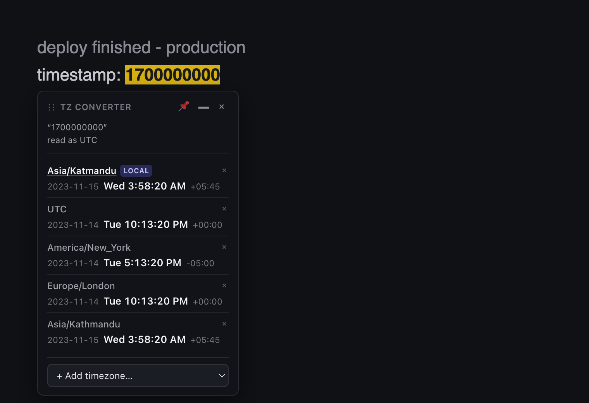
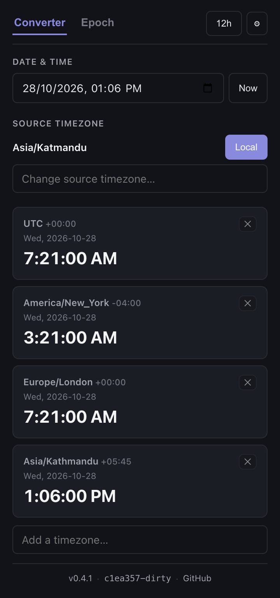

# TZ Converter — Timezone Tools

A Manifest V3 browser extension for timezone conversion. Works in Chromium (Chrome, Edge, Brave) and Firefox.

**[Website](https://maskeynihal.github.io/tz-extension/)** · **[Live converter](https://maskeynihal.github.io/tz-extension/app.html)** · **[Latest release](https://github.com/maskeynihal/tz-extension/releases/latest)**

No install needed to try it — the [online converter](https://maskeynihal.github.io/tz-extension/app.html) runs the same engine the extension ships.

## Demo

https://github.com/maskeynihal/tz-extension/raw/main/docs/assets/launch.mp4

<sub>A 20-second tour. If the player doesn't load, [download the MP4](https://github.com/maskeynihal/tz-extension/raw/main/docs/assets/launch.mp4).</sub>

| Select to convert | Full converter |
|---|---|
|  |  |

## Features

1. **Select to convert.** Select any text on a page. If it parses as a date/time, a small popover appears next to your selection showing that time in your chosen timezones. Renders in an isolated Shadow DOM, clamps to the viewport, and stays silent when the selection is not a time.
2. **Full converter.** The toolbar popup takes a date + source timezone and shows it in any number of target zones. "Now" button, 12/24-hour toggle, DST-correct, inline validation.
3. **Epoch converter.** Paste a Unix timestamp (seconds or milliseconds — auto-detected, overridable) to see it in your zones plus ISO-8601 UTC. Reverse direction too: a date back to an epoch.

Zones are managed on the options page (add, reorder, remove) and persisted via `chrome.storage`.

## Install (unpacked)

### Chrome / Edge

1. `npm run build:chrome` → produces `dist/`
2. Open `chrome://extensions`, enable **Developer mode**.
3. **Load unpacked** → select `dist/`.

### Firefox

1. `npm run build:firefox` → produces `dist-firefox/`
2. Open `about:debugging` → **This Firefox** → **Load Temporary Add-on**.
3. Select `dist-firefox/manifest.json`.

> The Firefox add-on id is a placeholder (`tz-converter@maskeynihal`). Change it in `scripts/firefox-manifest.mjs` before submitting to addons.mozilla.org.

## Development

```bash
npm install          # install dependencies
npm run dev          # Vite dev server (Chrome manifest)
npm run dev:firefox  # Vite dev server (Firefox manifest)
```

## Build & package

| Command | Output |
|---|---|
| `npm run build:chrome` | `dist/` |
| `npm run build:firefox` | `dist-firefox/` |
| `npm run build:all` | both |
| `npm run zip:chrome` | `tz-extension-chrome.zip` |
| `npm run zip:firefox` | `tz-extension-firefox.zip` |
| `npm run zip:all` | both zips |

Zips contain the extension at the top level (manifest at root), source maps stripped — ready for the Chrome Web Store and AMO.

## Quality gate

```bash
npm run typecheck    # tsc --noEmit (strict, no any)
npm run lint         # eslint, zero warnings
npm test             # vitest unit tests
npm run e2e          # playwright smoke test
```

## Stack

- **Build:** Vite 5 + `@crxjs/vite-plugin` 2
- **UI:** React 18 + TypeScript (strict)
- **Time:** `date-fns` + `date-fns-tz` (DST-correct, fractional offsets)
- **Tests:** Vitest + Testing Library (unit), Playwright (e2e)

## Permissions

Only `storage` — for saving your zone list. No `host_permissions`. The content script runs at `document_idle` on all pages purely to read your text selection; nothing leaves the browser.

## Project layout

```
src/
  background/   MV3 service worker (seeds default prefs on install)
  content/      select-to-convert popover (Shadow DOM)
  popup/        converter + epoch tabs
  options/      manage saved zones
  lib/          parse.ts, tz.ts, epoch.ts, storage.ts (the tested core)
  types/        shared types
scripts/
  firefox-manifest.mjs   rewrites the manifest to Firefox MV3 shape
```

## License

Not yet licensed. Add a `LICENSE` file (MIT is a reasonable default) before publishing.
