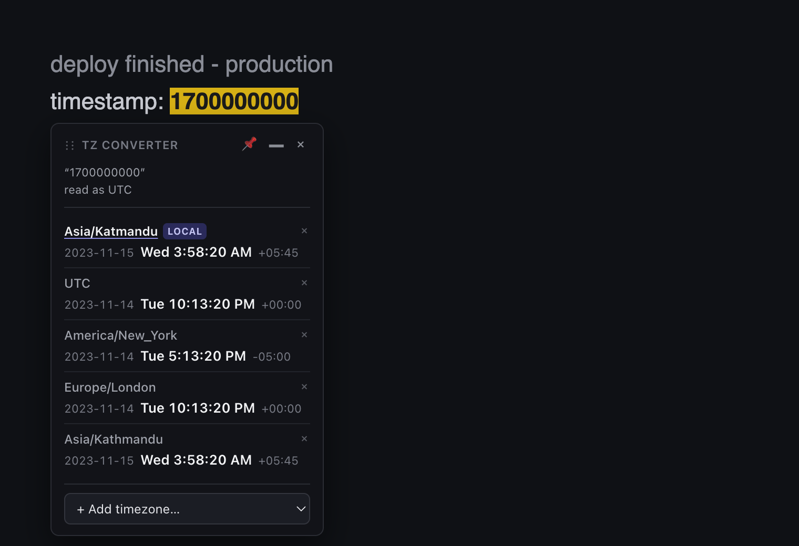
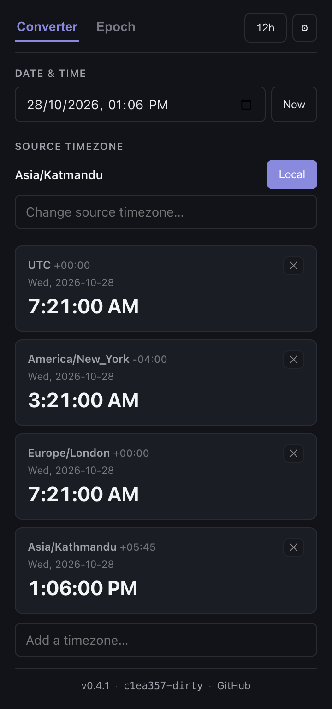

# TZ Converter — Timezone Tools

[](https://chromewebstore.google.com/detail/tz-converter-%E2%80%94-timezone-t/cokhjgalkhboifkgoomlbaigocjpmhkk) [](https://addons.mozilla.org/en-US/firefox/addon/tz-converter-timezone-tools/)

A Manifest V3 browser extension for timezone conversion. Works in Chromium (Chrome, Edge, Brave) and Firefox.

**[Chrome Web Store](https://chromewebstore.google.com/detail/tz-converter-%E2%80%94-timezone-t/cokhjgalkhboifkgoomlbaigocjpmhkk)** · **[Firefox Add-ons](https://addons.mozilla.org/en-US/firefox/addon/tz-converter-timezone-tools/)** · **[Website](https://tz.nihal.com.np/)** · **[Live converter](https://tz.nihal.com.np/app)** · **[Latest release](https://github.com/maskeynihal/tz-extension/releases/latest)** · **[Privacy](https://tz.nihal.com.np/privacy)**

No install needed to try it — the [online converter](https://tz.nihal.com.np/app) runs the same engine the extension ships.

## Demo

A real walkthrough of every feature, in an actual browser:

https://github.com/maskeynihal/tz-extension/raw/main/docs/assets/demo-real.mp4

<sub>Can't see the player? <a href="https://github.com/maskeynihal/tz-extension/raw/main/docs/assets/demo-real.mp4">Download the demo</a> · or watch the <a href="https://github.com/maskeynihal/tz-extension/raw/main/docs/assets/launch.mp4">20-second montage</a>.</sub>

| Select to convert | Full converter |
|---|---|
|  |  |

## Features

1. **Select to convert.** Select any text on a page. If it parses as a date/time, a small popover appears next to your selection showing that time in your chosen timezones. Renders in an isolated Shadow DOM, clamps to the viewport, and stays silent when the selection is not a time.
2. **Full converter.** The toolbar popup takes a date + source timezone and shows it in any number of target zones. "Now" button, 12/24-hour toggle, DST-correct, inline validation.
3. **Epoch converter.** Paste a Unix timestamp (seconds or milliseconds — auto-detected, overridable) to see it in your zones plus ISO-8601 UTC. Reverse direction too: a date back to an epoch.
4. **Right-click to convert.** Select text, right-click, and choose **Convert “…” with TZ Converter**. Works even when automatic select-to-convert is off, and says so when the selection holds no time it recognizes.
5. **Formats you control.** The settings page lists every built-in format (with its regular expression) and lets you switch any of them off. Add your own formats with tokens such as `DD/MM/YYYY HH:mm`, `MMM D, YYYY h:mm A` or `DD.MM.YYYY [um] HH:mm`, or with a raw regex using named groups. A live tester shows which format matches a piece of text.

6. **Hundreds of date layouts.** Every layout in the [Talend/Qlik date format list](https://help.qlik.com/talend/en-US/data-preparation-user-guide/8.0/list-of-date-and-date-time-formats) is recognized: numeric dates in any order and separator (`22/03/1999`, `3/22/99 5:06 AM`, `22.03.1999 um 05:06 MEZ`, `1999.03.22.`), compact (`19990322`), ISO ordinal and week dates, `[Europe/Paris]` zones, the Unix `date` output, written dates in English, German, French, Spanish, Italian, Portuguese and Dutch, and Chinese/Japanese dates. When a date like `03/04/2024` could be read day-first or month-first, the card lets you pick and remembers the choice.
7. **Copy-friendly.** Your selection is never removed: select a paragraph that contains a time and you can still copy all of it.
   - **Several times in one selection.** The card shows a stepper, `‹ 2 of 3 ›` (`‹ 2/3 ›` on a compact card). Times are numbered in the order they appear in the text; the card opens on the most specific one (a full timestamp before a bare `9:00`), so it may open on "2 of 3". Next and Previous wrap around, the mark on the page moves to the time shown, and stepping to a time off screen scrolls it into view and moves the card next to it. Repeated identical times (same text, same instant) count once. Text you can't see (positioned off the page, screen-reader-only, `opacity: 0` or a transparent colour) is skipped; text scrolled out of view inside a scrolling pane or code block still counts, either way (a bottom-anchored chat scrolled up, a right-to-left page or pane scrolled sideways). Up to 500 times are listed; the count ends in `+` ("1 of 500+") when there are more, or when the selection is very long: only its first 50,000 characters are read, and then even a single time shows "1 of 1+". When the card's best time is off screen, it opens on the visible time nearest where you released the mouse. Pinning a card pins the time it shows, and a pinned card keeps the stepper.
   - **Where pins go.** Pinning a card never moves the cards already pinned. The new one takes the first free spot (one that covers no other pin, no other pin's text and not its own text), preferring spots wholly on screen: right below its text, else to the right of it when the screen has room, else the nearest free spot around it (the empty columns right of other pins included). When there is none, it stacks below the lowest card in the way, further down the page (on a narrow screen, pins stack one under another), and the page scrolls so the new pin is in view. On a page whose window doesn't scroll (an app shell with its own scrolling pane, such as web mail or chat), pins always stay on screen, overlapping if they must, and the page is never scrolled. "Pin all to page" puts floating cards back one by one in the order their text appears, by the same rule; a card whose text is scrolled away goes back by its text rather than on screen. A pin that steps to a time under itself moves to a free spot on screen just above, below or beside that time, or stays put when there is none; it can still sit over another pin's time.
   - **Keyboard.** A card that opens while you type does not take your focus. Press **Alt+Shift+K** (**Ctrl+Shift+K** on macOS) to move focus into the open card, Tab through its buttons, and press the key again to go back to where you were; **Escape** closes the card and returns focus. The key is a browser extension shortcut, so it never blocks a page's own keys. To change it, open `chrome://extensions/shortcuts` (Chrome, Edge: `edge://extensions/shortcuts`) or, in Firefox, Add-ons and themes → ⚙ → Manage Extension Shortcuts, and set "Move focus to the open conversion card and back". If the browser left it unassigned (another extension already uses the key), the card's hint says to set one there.
   - Open cards follow settings changed elsewhere (Settings, another tab): day/month order, 12/24-hour clock, target and home zones, and formats, staying on the same time.
8. **Zones your way.** Every zone list is searchable and grouped: IANA cities, fixed offsets (`UTC+05:45`, `UTC−08:00`), abbreviations (`PDT`, `EDT`, `CET`, `IST`, `AEST`…) and the DST-aware `PT`, `MT`, `CT`, `ET`.
9. **Pins with a dock.** Pin cards to compare times; once something is pinned, a small dock offers Minimize all, Expand all, Unpin all (float the cards on screen so they stay in view) and Close all with Undo.
10. **World clock.** A full-page board of all your zones: live times, difference from home, today/tomorrow, day or night, working hours, and a scrubber to plan a time across zones. Open it from the popup, or [online](https://tz.nihal.com.np/clock).

Settings (tabbed: General · Cards · Timezones · Formats) also cover: home zone, target zones (drag to reorder, add, remove), 12/24-hour clock, theme, card size on open (compact, full or last used), numeric date order, the date-only time policy, highlighting the matched text, and **Convert when I select text** (turn it off to convert only from the right-click menu). Everything is persisted via `chrome.storage`; the website keeps the same settings in `localStorage`.

### Custom format tokens

| Token | Meaning | Token | Meaning |
|---|---|---|---|
| `YYYY` / `YY` | 4- / 2-digit year | `HH` / `H` | hour 00-23 / 0-23 |
| `MM` / `M` | month 01-12 / 1-12 | `hh` / `h` | hour 01-12 / 1-12 (needs `A`) |
| `MMMM` / `MMM` | month name / short name | `mm`, `ss`, `SSS` | minutes, seconds, milliseconds |
| `DD` / `D` / `Do` | day 01-31 / 1-31 / 5th | `A` | AM/PM, any case, `a.m.` too |
| `TZ` | `UTC`, `EST`, `+05:45`, `GMT+1` | `[text]` | literal text, e.g. `[at]` |
| `dddd` / `ddd` | weekday name / short name (must be a weekday name; not checked against the date) | `SSSS`…`SSSSSSSSS` | 4 to 9 fraction digits (the first 3 are read) |

Java and Talend patterns (`yyyy-MM-dd'T'HH:mm:ssXXX`, `dd MMM yyyy HH:mm:ss z`) work too:

| Token | Meaning | Token | Meaning |
|---|---|---|---|
| `yyyy` / `yy` | 4- / 2-digit year | `a` | AM/PM, like `A` |
| `dd` / `d` | day 01-31 / 1-31 | `EEEE` / `EEE` | weekday name / short name (must be a weekday name; not checked against the date) |
| `X` / `XX` / `XXX` | `+05` / `+0545` / `+05:45`, or `Z` | `Z` | `+0545`, `-0800` (`+05:45` and `Z` too) |
| `z` / `zzz` | zone, like `TZ` | `'text'` | literal text, e.g. `'T'`, `'at'` |
| `''` | one quote, e.g. `dd MMM ''yy` for `05 Mar '24` | | |

The Java letters are tokens only where no other letter touches them, so the letters of a word ("today", "den", "daily", "Zulu") are matched as written. A pattern saved earlier that is not valid with these letters read as tokens (`HH:mm TZ (Z)` would set the zone twice) is read the old way, with them as plain text. `DDD` (day of the year) and more than 9 fraction digits are not supported, and say so.

Zones after a time can be `Z`, an offset (`+05:45`), `GMT+5:30` / `UTC-8`, or an abbreviation written in capitals (`EST`, `CET`, `IST`, `AEST`, `NPT`…; `UTC`/`GMT` in any case). `ET`, `CT`, `MT` and `PT` follow US daylight saving. Lower-case words are never read as zones, so "12:30 eat" stays in your home zone. The same goes for `TZ`, `z` and `zzz` in a custom format: a lower-case abbreviation such as `est` or `pst` is not read.

A format needs a month and a day, or just a time (it then means today). The year is optional (defaults to this year). When formats overlap, the longest match wins; on a tie, custom formats beat built-ins. Raw regexes must use the groups `y yy mo moName d h mi s ms ap zone`. To keep every page responsive they may not repeat a group that itself repeats or branches (`(a+)+`, `(a|b)+`), may use only a couple of open-ended repeats (`+`, `*`; prefer bounded ones like `\d{1,4}`), may not use backreferences, can look behind at most 32 characters, match at most 80 characters, and scan the first 500 characters of a selection. Each selection also has a hard time budget, so a slow regex is cut short instead of freezing the page. A time right after a date that no enabled format reads is not shown as "today"; add a custom format for that date instead.

## Install

- **Chrome, Edge, Brave and other Chromium browsers:** [Chrome Web Store](https://chromewebstore.google.com/detail/tz-converter-%E2%80%94-timezone-t/cokhjgalkhboifkgoomlbaigocjpmhkk)
- **Firefox:** [Firefox Add-ons](https://addons.mozilla.org/en-US/firefox/addon/tz-converter-timezone-tools/)

Store updates follow each GitHub release once the store review passes.

### From source (unpacked)

#### Chrome / Edge

1. `npm run build:chrome` → produces `dist/`
2. Open `chrome://extensions`, enable **Developer mode**.
3. **Load unpacked** → select `dist/`.

#### Firefox

1. `npm run build:firefox` → produces `dist-firefox/`
2. Open `about:debugging` → **This Firefox** → **Load Temporary Add-on**.
3. Select `dist-firefox/manifest.json`.

Prebuilt `tz-extension-chrome.zip` and `tz-extension-firefox.zip` are attached to every [release](https://github.com/maskeynihal/tz-extension/releases/latest); unzip one and load the folder the same way.

## Development

```bash
npm install          # install dependencies
npm run dev          # Vite dev server (Chrome manifest)
npm run dev:firefox  # Vite dev server (Firefox manifest)
```

## Build & package

| Command | Output |
|---|---|
| `npm run build:chrome` | `dist/` |
| `npm run build:firefox` | `dist-firefox/` |
| `npm run build:all` | both |
| `npm run zip:chrome` | `tz-extension-chrome.zip` |
| `npm run zip:firefox` | `tz-extension-firefox.zip` |
| `npm run zip:all` | both zips |
| `npm run zip:source` | `tz-extension-source.zip` (tracked files, for AMO review) |

Zips contain the extension at the top level (manifest at root), source maps stripped — ready for the Chrome Web Store and AMO.

## Releasing

Every merge to `main` bumps the version from Conventional Commits, tags it, attaches both zips to a GitHub release, and submits the new version to the Chrome Web Store and Firefox Add-ons. Store credentials, local dry runs, and re-publishing a tag are covered in [PUBLISHING.md](PUBLISHING.md).

## Quality gate

```bash
npm run typecheck    # tsc --noEmit (strict, no any)
npm run lint         # eslint, zero warnings
npm test             # vitest unit tests
npm run e2e          # playwright smoke test
```

## Stack

- **Build:** Vite 5 + `@crxjs/vite-plugin` 2
- **UI:** React 18 + TypeScript (strict)
- **Time:** the browser's `Intl` time zone data, no time library (DST-correct, fractional offsets)
- **Tests:** Vitest + Testing Library (unit), Playwright (e2e)

## Permissions

- `storage`: saves your settings.
- `contextMenus`: the right-click **Convert “…”** item.
- `activeTab` + `scripting`: if you use that item in a tab where the content script is not running yet (opened before install or update, or a Firefox site you have not granted access to), it is injected into that tab after your click.

No `host_permissions`. The content script runs at `document_idle` on all pages purely to read your text selection; nothing leaves the browser.

## Project layout

```
src/
  background/   MV3 service worker (seeds prefs, right-click menu, on-demand injection)
  content/      select-to-convert popover (Shadow DOM)
  popup/        converter + epoch tabs
  options/      settings: zones, preferences, formats (Formats.tsx)
  lib/          parse.ts (orchestrates matching), builtin-formats.ts (format
                registry), custom-formats.ts (token/regex compiler),
                time-tokens.ts, tz.ts, epoch.ts, storage.ts, messages.ts
  types/        shared types
scripts/
  firefox-manifest.mjs   rewrites the manifest to Firefox MV3 shape
  publish-chrome.mjs     uploads + submits a zip to the Chrome Web Store (API v2)
  publish-firefox.mjs    submits a zip + source archive to AMO via web-ext sign
  source-archive.mjs     builds tz-extension-source.zip with git archive
```

## License

Not yet licensed. Add a `LICENSE` file (MIT is a reasonable default) before publishing.
